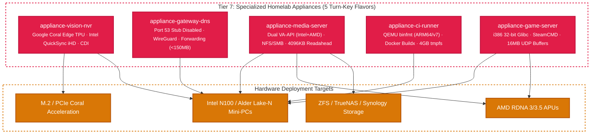

<!-- markdownlint-disable MD013 MD024 -->
# Tier 7: Specialized Homelab Appliances

> Purpose-engineered, turn-key cloud and bare-metal OS appliances addressing the top friction points identified across [r/homelab](https://reddit.com/r/homelab) and the Steam Hardware Survey.

---

## Overview & Architecture

Homelab operators frequently encounter a difficult trade-off: rigid, heavyweight ISO appliances (e.g. TurnKey Linux) that create port conflicts and lag upstream security updates, versus bare cloud images that require complex out-of-tree kernel modules, manual udev permissions, and intricate network stack tuning.

The **Lusoris Tier 7 Appliances** solve this by delivering hardened, pre-baked appliances optimized for containerized homelab services while maintaining the zero-bloat, fast-boot invariants of the Lusoris forge.



---

## 1. Vision & Home NVR (`appliance-vision-nvr`)

| Attribute | Specification |
| :--- | :--- |
| **Primary Workloads** | [Frigate NVR](https://frigate.video), [Scrypted](https://scrypted.app), Home Assistant AI |
| **Hardware Acceleration** | Google Coral Edge TPU (PCIe, M.2 Key E/M, USB) + Intel QuickSync VA-API (`iHD`) |
| **Kernel Profile** | `generic` (Host I/O scheduler: `mq-deadline`) |
| **Container Engine** | Docker CE 29.8 with native CDI specification (`coral.google.com/edgetpu`) |

### Key Features

- **Zero-Friction Coral TPU**: Pre-installs out-of-tree kernel module dependencies and sets up `/etc/udev/rules.d/65-edgetpu.rules` with `render` group ownership, enabling rootless Frigate detection.
- **Intel QuickSync Passthrough**: Pre-configures `intel-media-va-driver-non-free` and `vainfo` for low-power hardware video decode of H.264/H.265 RTSP camera feeds.
- **Container Device Interface (CDI)**: Delivers `/etc/cdi/coral.yaml` allowing Docker and containerd to mount Coral TPUs using standard `--device coral.google.com/edgetpu=apex0` flags.

---

## 2. High-Availability Gateway & DNS (`appliance-gateway-dns`)

| Attribute | Specification |
| :--- | :--- |
| **Primary Workloads** | [AdGuard Home](https://adguard.com), [Pi-hole](https://pi-hole.net), [Unbound](https://nlnetlabs.nl/projects/unbound/), [WireGuard](https://www.wireguard.com) |
| **Resource Footprint** | Ultralight (< 150MB baseline RAM idle) |
| **Port Invariant** | Port 53 fully unbound and exposed (`systemd-resolved` stub disabled) |
| **Routing Engine** | Native WireGuard kernel module autoload + IPv4/IPv6 packet forwarding |

### Key Features

- **Port 53 Freedom**: Automatically overrides `systemd-resolved` with `DNSStubListener=no` and repoints `/etc/resolv.conf`, eliminating the ubiquitous `address already in use` error when deploying DNS containers.
- **Line-Rate Packet Forwarding**: Tunes sysctl with `net.ipv4.ip_forward = 1` and `net.ipv6.conf.all.forwarding = 1` while disabling ICMP redirect spoofing.
- **WireGuard Ready**: Pre-loads `wireguard.ko` on system boot, enabling instant site-to-site tunnels and overlay networking.

---

## 3. Media Transcoding & Streaming Server (`appliance-media-server`)

| Attribute | Specification |
| :--- | :--- |
| **Primary Workloads** | [Jellyfin](https://jellyfin.org), [Plex Media Server](https://plex.tv), [Tdarr](https://tdarr.io) |
| **Hardware Acceleration** | Dual-vendor VA-API: Intel Media Driver (`iHD`) + AMD Mesa VA-API (`radeonsi`) |
| **Storage Integration** | `nfs-common` (NFSv4), `cifs-utils` (SMB3), `autofs`, `fuse3` |
| **Streaming Engine** | 4096KB block device readahead (`read_ahead_kb = 4096`) |

### Key Features

- **Dual-Vendor GPU Transcoding**: Enables hardware-accelerated transcoding regardless of whether the VM runs on an Intel N100 mini-PC, modern Core i7 iGPU, or AMD Radeon APU (RDNA 3/3.5).
- **Smooth 4K Remux Playback**: Configures dynamic 4096KB readahead rules to eliminate network and disk stalls during high-bitrate media playback.
- **NAS-Optimized Mounting**: Ships essential network filesystem drivers so remote TrueNAS/Unraid shares mount without host tool installation.

---

## 4. Self-Hosted CI/CD Multi-Arch Runner (`appliance-ci-runner`)

| Attribute | Specification |
| :--- | :--- |
| **Primary Workloads** | GitHub Actions Runner, GitLab Runner, Forgejo Runner, Gitea Actions |
| **Multi-Arch Emulation** | QEMU `binfmt_misc` user-space emulation (`qemu-user-binfmt`) for ARM64/ARMv7 |
| **Build Tooling** | Docker CE 29.8, Docker Buildx, `git-lfs`, `zstd`, `jq`, `rsync`, `build-essential` |
| **Filesystem Tuning** | 4GB volatile `/tmp` in-memory tmpfs mount |

### Key Features

- **Cross-Platform Container Builds**: Enables `docker buildx build --platform linux/amd64,linux/arm64` out of the box without requiring manual binfmt registration containers.
- **High-Speed In-Memory Scratch**: Mounts `/tmp` on tmpfs to drastically accelerate compilation, object linking, and artifact compression while prolonging host SSD endurance.
- **Batteries-Included Toolchain**: Ships with Git Large File Storage (LFS) and standard build tools for immediate runner registration.

---

## 5. Dedicated Game Server Host (`appliance-game-server`)

| Attribute | Specification |
| :--- | :--- |
| **Primary Workloads** | [SteamCMD](https://developer.valvesoftware.com/wiki/SteamCMD), [Pterodactyl Wings](https://pterodactyl.io), CS2, Palworld, Valheim |
| **Runtime Architecture** | Multiarch 32-bit `i386` glibc + 64-bit `amd64` container runtime |
| **Network Optimization** | Low-latency, high-burst UDP socket buffer tuning (`rmem_max = 16MB`, `wmem_max = 16MB`) |
| **Resource Limits** | 1,048,576 open file descriptors (`nofile`) & `vm.max_map_count = 1048576` |

### Key Features

- **Multiarch Steam Runtime**: Enables `i386` architecture and pre-installs 32-bit glibc, libstdc++, and SDL2 runtimes required by dedicated game servers.
- **Packet Loss Elimination**: Increases default UDP socket buffers to 16MB to absorb bursty multiplayer traffic spikes without dropping client packets.
- **Pterodactyl Ready**: Configures elevated system limits (1M open files and 1M memory maps) to host dozens of concurrent game server instances reliably.

---

## Build Targets

```bash
# Build Vision NVR appliance
make build-appliance-vision-nvr

# Build DNS Gateway appliance
make build-appliance-gateway-dns

# Build Media Transcoding appliance
make build-appliance-media-server

# Build CI/CD Runner appliance
make build-appliance-ci-runner

# Build Dedicated Game Server appliance
make build-appliance-game-server
```
