# Bare-Metal & iPXE Deployment Guide

`lusoris-cloud-images` provides bare-metal optimized images with physical hardware tuning, microcode errata mitigations, and storage expansion.

## 1. Direct Block Flashing (`lusoris-install-to-disk`)

You can flash a compressed `.raw.zst` directly to physical NVMe or SATA storage from any live rescue environment (e.g. Ubuntu live CD, SystemRescue, Hetzner Rescue).

Each release of your fork carries the raw disk image of every flavor that `.github/workflows/release-matrix.yml` builds (`base-generic`, `docker-generic`, `k8s-node-generic`) as `lusoris-cloud-<flavor>.raw.zst`, next to the `.qcow2.zst`. Both are listed in the release's `SHA256SUMS`, which the workflow signs with cosign. The helper needs the raw image: handed a `.qcow2.zst`, it finds no partition table and stops. The target disk must be at least the image's disk size (20 GiB, `disk_size` in `packer/variables.pkr.hcl`); the first boot grows the root partition to fill it.

Set `OWNER` to the account or organisation that holds your fork and `TAG` to the release you want, then check the image against the signed checksums before you write it:

```bash
OWNER=your-account
TAG=v0.1.0
for asset in lusoris-cloud-base-generic.raw.zst SHA256SUMS SHA256SUMS.bundle; do
  curl -fsSLO "https://github.com/${OWNER}/imago/releases/download/${TAG}/${asset}"
done
cosign verify-blob --bundle SHA256SUMS.bundle \
  --certificate-identity "https://github.com/${OWNER}/imago/.github/workflows/release-matrix.yml@refs/tags/${TAG}" \
  --certificate-oidc-issuer https://token.actions.githubusercontent.com SHA256SUMS
sha256sum --check --ignore-missing SHA256SUMS
```

Write the checked file with the built-in helper utility, which refuses a target that is no block device and an image without a partition table:

```bash
lusoris-install-to-disk lusoris-cloud-base-generic.raw.zst /dev/nvme0n1
```

Or stream it straight from the release without storing it, which skips the checksum check:

```bash
curl -fsSL "https://github.com/${OWNER}/imago/releases/download/${TAG}/lusoris-cloud-base-generic.raw.zst" | \
  zstdcat | sudo dd of=/dev/nvme0n1 bs=4M status=progress conv=fsync
```

The helper refuses a target that is not a block device. After the write it reads the first sector of the target and fails unless it ends with the boot signature `0x55 0xAA` that an MBR disk and the protective MBR of a GPT disk both carry, so a `.qcow2.zst` or any other non-raw image is reported instead of announced as ready to boot. `tests/test_install_to_disk.py` flashes images onto a loop device to check this.

```mermaid
flowchart LR
    %% Semantic class definitions with vibrant, high-contrast jewel palettes
    classDef rescue fill:#d97706,stroke:#b45309,stroke-width:2px,color:#ffffff
    classDef remote fill:#0284c7,stroke:#0369a1,stroke-width:2px,color:#ffffff
    classDef disk fill:#7c3aed,stroke:#6d28d9,stroke-width:2px,color:#ffffff
    classDef boot fill:#059669,stroke:#047857,stroke-width:2px,color:#ffffff

    subgraph RescueEnv["Live Rescue Environment (RAM / Netboot)"]
        Curl["curl -fsSL (HTTP Stream)"]:::rescue
        Zstd["zstdcat (Decompress Stream)"]:::rescue
        DD["dd of=/dev/nvme0n1 bs=4M conv=fsync"]:::rescue
        Curl -->|Unix Pipe| Zstd -->|Raw Blocks| DD
    end

    subgraph RemoteStorage["Release Server / Object Storage"]
        RemoteImg[("lusoris-*.raw.zst<br/><small>Compressed Image Stream</small>")]:::remote
    end

    subgraph TargetDrive["Target Physical NVMe / SATA Disk"]
        GPT["GPT Partition Table<br/><small>Root Partition (20GB)</small>"]:::disk
    end

    subgraph FirstBoot["First Boot Sequence"]
        Growpart["growpart & resize2fs<br/><small>Expands to fill 100% of Drive</small>"]:::boot
        FullRoot[("Expanded Root Filesystem<br/><small>Full Capacity Online</small>")]:::boot
        Growpart --> FullRoot
    end

    RemoteImg -->|Network Stream| Curl
    DD -->|Direct Write| GPT
    GPT -.-> FirstBoot

    style RescueEnv fill:none,stroke:#d97706,stroke-width:2px,stroke-dasharray: 4 4
    style RemoteStorage fill:none,stroke:#0284c7,stroke-width:2px,stroke-dasharray: 4 4
    style TargetDrive fill:none,stroke:#7c3aed,stroke-width:2px,stroke-dasharray: 4 4
    style FirstBoot fill:none,stroke:#059669,stroke-width:2px,stroke-dasharray: 4 4
```



---

## 2. Automatic Root Disk Expansion

When flashing a 20GB `.raw.zst` image onto a 1TB, 2TB, or larger physical drive, `cloud-guest-utils` and `growpart` automatically resize the root GPT partition and filesystem to fill 100% of the drive on first boot.

## 3. CPU Microarchitecture & Hardware Profiles

- **Intel Bare-Metal**: Configured with `intel-microcode`, `intel_iommu=on iommu=pt`, and `intel_pstate=active`.
- **AMD Bare-Metal**: Configured with `amd64-microcode`, `amd_iommu=on iommu=pt`, and `amd_pstate=active`.
- **Physical NIC Drivers**: Pre-loads network firmware (`linux-firmware`) for Intel (`ice`, `i40e`, `ixgbe`), Broadcom (`bnxt_en`), and Mellanox ConnectX (`mlx5_core`).
- **NVMe Storage Scheduling**: Udev rules enforce `none` scheduler for NVMe drives to bypass CPU scheduler latency.

## 4. iPXE Netboot Chainloading

A release ships no netboot kernel or initrd; serve them and the NoCloud seed from a boot server of your own. Example iPXE configuration snippet, with `boot.example.com` standing for that server:

```ipxe
#!ipxe
kernel https://boot.example.com/netboot/vmlinuz ip=dhcp root=/dev/ram0 ds=nocloud;s=http://boot.example.com/cloud-init/
initrd https://boot.example.com/netboot/initrd.img
boot
```
