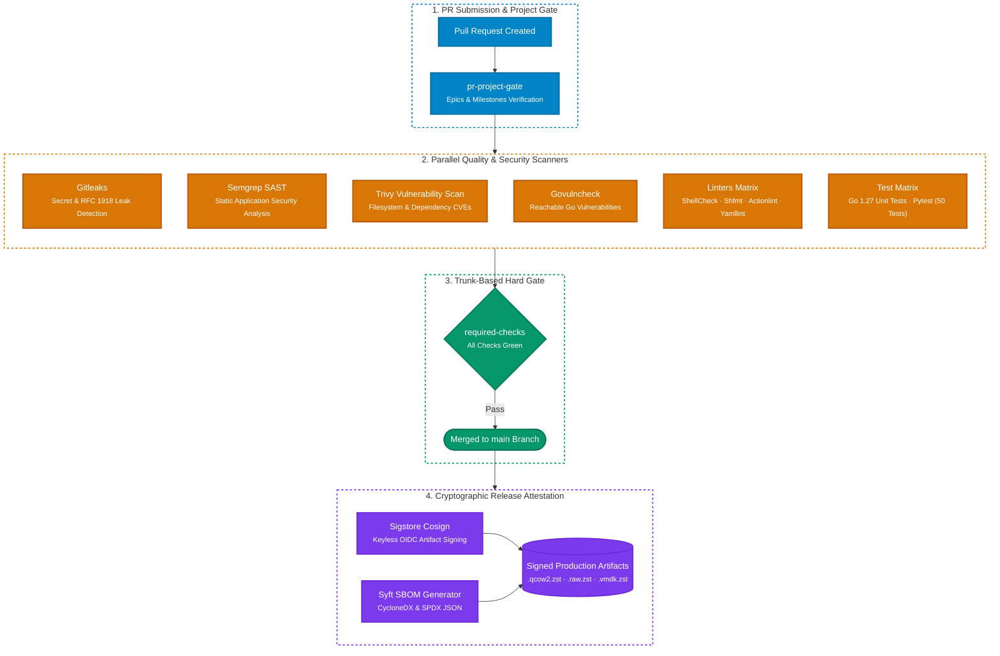

# Supply Chain Security & Attestation

Every official `lusoris-cloud-images` release follows modern supply-chain security best practices:

## 1. Cryptographic Signing via Cosign

A published release carries one `SHA256SUMS` that lists every image (`*.qcow2.zst`, and `*.raw.zst` for flashing to a disk), the four netboot assets of each flavor (`*-netboot.vmlinuz`, `*-netboot.initrd`, `*-root.squashfs`, `*.ipxe`; see [bare metal](../platforms/baremetal.md#4-ipxe-netboot)) and every SBOM of the release, and a Sigstore bundle `SHA256SUMS.bundle` that signs it. The `sign` job of [`release-matrix.yml`](https://github.com/cordanaLLM/imago/blob/main/.github/workflows/release-matrix.yml) runs after every flavor has built: it merges the per-flavor checksum files with `tools/ci/release_assets.py merge`, signs the result with `cosign sign-blob --bundle` (keyless, bound to the workflow and the release tag through GitHub's OIDC token), verifies the bundle and uploads both files. Signing runs on a published release only; a scheduled or manual run builds and catalogues but signs nothing, because a keyless signature writes a public transparency-log entry.

To check a download, verify the bundle against the workflow identity at the release tag, then the checksums:

```bash
cosign verify-blob \
  --bundle SHA256SUMS.bundle \
  --certificate-identity "https://github.com/cordanaLLM/imago/.github/workflows/release-matrix.yml@refs/tags/v0.1.0" \
  --certificate-oidc-issuer "https://token.actions.githubusercontent.com" \
  SHA256SUMS
sha256sum --check --ignore-missing SHA256SUMS
```

## 2. Software Bill of Materials (SBOM)

Every flavor of a release ships two SBOMs, generated by **Syft** from the built image:

- **CycloneDX JSON** (`sbom-<flavor>.cdx.json`)
- **SPDX JSON** (`sbom-<flavor>.spdx.json`)

Syft cannot read a qcow2 disk; pointed at the file it writes a valid but empty SBOM. The build job therefore attaches the image read-only through `qemu-nbd`, mounts its `cloudimg-rootfs` partition read-only and lets Syft catalogue that tree (`tools/ci/release_assets.py attach` and `detach`). `tools/ci/release_assets.py check` then fails the job unless each document lists at least 100 Debian packages, so an empty catalogue never ships. The SBOMs are named in `SHA256SUMS` and so covered by its signature. Every run, including the weekly schedule, keeps the SBOMs and checksum file as a workflow artifact named `checksums-<flavor>`.

`tests/test_release_assets.py` runs the attach, detach, check and merge commands against stubbed system tools, including the failure and boundary cases, and checks the workflow wiring.

## 3. Automated Vulnerability Scanning

Images and repository code are continuously scanned via **Trivy** and **Semgrep** in CI, halting releases if unpatched `CRITICAL` CVEs are detected.

The Trivy job reads its file patterns from [`.github/trivy.yaml`](https://github.com/cordanaLLM/imago/blob/main/.github/trivy.yaml), which adds the pinned pip lockfiles under `.github/requirements/`; trivy itself reads pip dependencies only from files named `requirements.txt`. After the scan, `tools/ci/trivy_coverage.py` compares the targets of the JSON report with the lockfiles `git ls-files` lists (`go.mod`, `package-lock.json`, `.github/requirements/*.txt`) and fails the job when a lockfile was not scanned. A new lockfile type needs a pattern in both files.

Before the Gitleaks and Semgrep jobs scan the repository, each runs [`tools/ci/scanner_canary.py`](https://github.com/cordanaLLM/imago/blob/main/tools/ci/scanner_canary.py). The canary writes planted findings into a temporary directory outside the checkout and scans them with the same binary and the repository's own configuration: a cosign private key header (the custom `no-cosign-private-key` rule of `.gitleaks.toml`) and a GitHub token (a default Gitleaks rule) for Gitleaks, and an `eval` call for the Semgrep rule sets. The job fails unless the scanner exits non-zero and reports every planted rule, so a broken rule, an unread config file or a flag that hides findings turns it red. The planted text is joined at run time, so the repository holds no finding. `tests/test_scanner_canary.py` runs the canary against a stub scanner and checks that every scan step runs it first.

Go code is also checked by **govulncheck**, which reports only vulnerabilities the code can reach. The `Govulncheck Reachable Go Vulnerabilities` job runs it on every Go change, on every push to `main` and on the weekly schedule, so a newly published advisory turns the job red without a code change. The scanner is pinned in its own module, [`tools/govulncheck/go.mod`](https://github.com/cordanaLLM/imago/blob/main/tools/govulncheck/go.mod), so its dependencies do not change the versions imago builds with, and Renovate updates it. To run the same scan locally: `go -C tools/govulncheck tool govulncheck -C "$PWD" ./...`.

Every `uses:` reference of a workflow is pinned to a commit with its release in a comment, and the **action pin check** holds that pin true. The `action-pins` workflow ([`.github/workflows/action-pins.yml`](https://github.com/cordanaLLM/imago/blob/main/.github/workflows/action-pins.yml)) runs [`tools/ci/action_pins.py`](https://github.com/cordanaLLM/imago/blob/main/tools/ci/action_pins.py), which runs [zizmor](https://docs.zizmor.sh/) (pinned with hashes in `.github/requirements/pins.txt`) online with the run token and fails on ten audits:

- `unpinned-uses`: a reference pinned to a tag or branch instead of a commit;
- `impostor-commit`: a commit that is not in the named repository, for example one that exists only in a fork;
- `ref-version-mismatch`: a version comment that names another release than the pinned commit, or none;
- `template-injection`: a `${{ }}` expression expanded inside a `run:` script instead of passed through `env`;
- `excessive-permissions`: a `read-all` or `write-all` grant;
- `undocumented-permissions`: a grant beyond `contents: read` without a comment on its line that says what it is for;
- `anonymous-definition`: a job without a `name:`;
- `artipacked`: a checkout that keeps the job token in `.git/config` (`persist-credentials: false` is missing);
- `concurrency-limits`: a workflow without a concurrency group;
- `superfluous-actions`: an action whose work a tool on the runner already does.

Every workflow checks out without keeping the token and declares a concurrency group; release runs are never cancelled. `pr-project-gate.yml` gives every run its own group: label and milestone events re-run it on the same head commit, and a cancelled run there would leave a cancelled check suite that holds the pull request blocked (`tests/test_pr_project_gate.py`). The one finding the repository cannot fix yet is listed in [`.github/zizmor-exceptions.json`](https://github.com/cordanaLLM/imago/blob/main/.github/zizmor-exceptions.json): `superfluous-actions` on the `create-pull-request` step of `sync-kernel-manifest.yml`, which signs its commit through the API where `gh pr create` cannot. The engine-written `praetor-docs.yml` sets `persist-credentials: false` and a concurrency group since engine 32a35c8fb947, so its `artipacked` and `concurrency-limits` entries are gone.

An exception uses the shape of the engine's exceptions in `.standards.yaml`: `rule` (the zizmor audit), `path` (the workflow), `reason` and `expires`. The reason starts with its rectification category, and the expiry lies at most that many days ahead: A states its own interval, B allows 3 days, C 10 days, and D 120 days; no entry runs longer than 90 days. The check prints each excepted finding as a warning and fails on an entry that has expired, runs past its category, lacks or adds a field, names an audit the check does not gate, repeats another entry or key, or matches no finding, so a fixed finding forces its entry out. The list exists because the engine accepts only its own rule ids as exceptions; it goes away when the engine accepts repository-declared rule ids (cordanaLLM/praetor#1206).

The check loads no zizmor configuration and honours no ignore comments, so the repository cannot relax a rule. It refuses to run without a token or with zizmor's offline switches, because `impostor-commit` asks the forge. Before the real scan it audits a planted workflow outside the checkout and fails unless each of the ten audits reports it, so an audit that a new zizmor version renames or that no longer reaches the forge turns the job red. The job runs on a pull request that changes a workflow, the lockfile, the exception list or the script, once a week (a release tag can move after the pin was written), and by hand; it needs the network, so it is not part of the local gate. `tests/test_action_pins.py` runs the script against a stub zizmor. To run it locally: `GH_TOKEN="$(gh auth token)" python3 -I tools/ci/action_pins.py --binary zizmor --exceptions .github/zizmor-exceptions.json .github/workflows`.

---

## 4. Continuous Assurance & PR Project Hard Gates

Every pull request is subjected to deterministic automated validation before reaching `main`:


