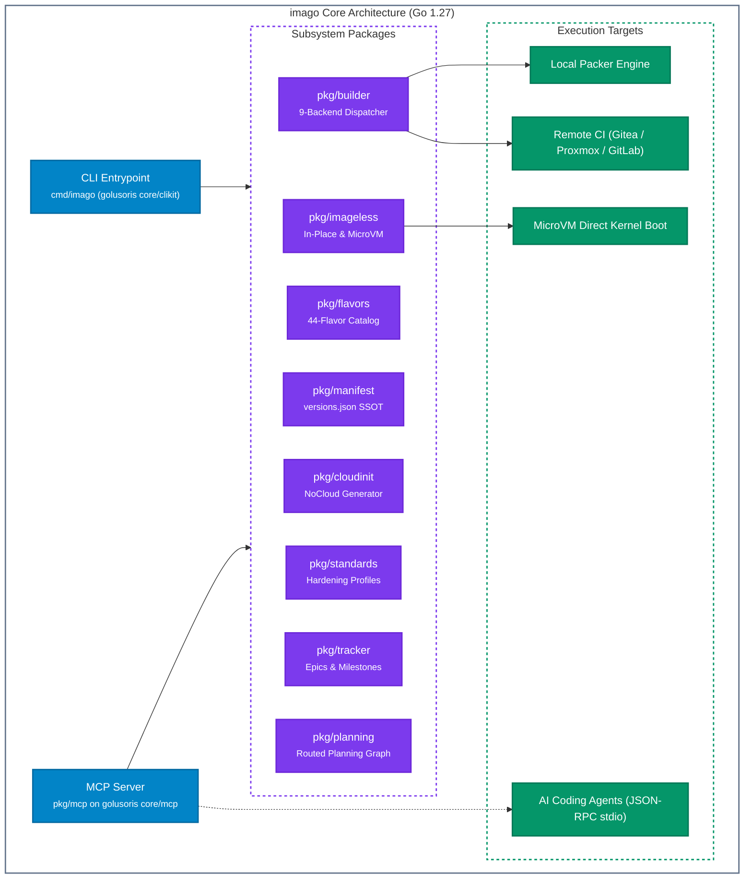
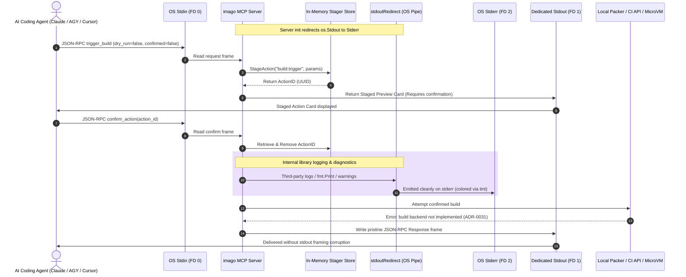
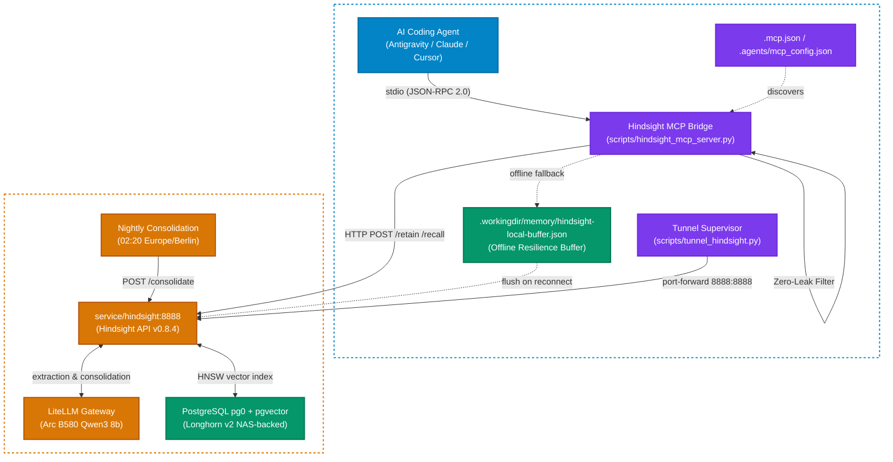

# Imago: Unified CLI & AI Model Context Protocol (MCP) Server

`imago` is the Go 1.27 engineering CLI and official Model Context Protocol (MCP) server of the image forge (`cordanaLLM/imago`, formerly `lusoris-cloud-images`). It unifies the 44-flavor catalog, cloud-init generator, multi-backend build dispatcher, imageless host provisioning, machine-verifiable hardening standards, recurring Epics/Milestones lifecycle tracking, and the routed planning graph. It is composed from [golusoris core](https://github.com/golusoris/golusoris): `core/clikit` builds the command tree, `core/log` provides the logger, `core/clock` supplies time, and `core/mcp` owns the MCP transport.

---

## 1. Architectural Principles

1. **Stdout Purity & Framing Protection**: In `stdio` MCP transport mode, golusoris `core/mcp` pins genuine `os.Stdout` exclusively for JSON-RPC message framing. All internal runtime messages and third-party library writes are redirected through an OS-level pipe to `os.Stderr`, preventing stream corruption. The guard lives in the framework; `imago` no longer carries its own copy.
2. **Single Source of Truth (`versions.json`)**: Version extraction and semantic assertions are performed directly against `versions.json` and `.github/epics.json`.
3. **Imageless Execution First**: Enables instant in-place host transformation or direct microVM kernel booting without requiring heavy disk imaging pipelines.
4. **Power of 10 & SEI CERT Compliance**: Every Go function is constrained to $\le 60$ statements with strict error wrapping (`%w`), zero goroutine leaks, and bounded timeouts.



---

## 2. Command-Line Interface (CLI) Reference

### 2.1 Flavor Catalog (`flavors`)

```bash
# List all 44 production flavors across all 7 tiers
imago flavors list

# Filter flavors by workload tier
imago flavors list --tier=kubernetes
imago flavors list --tier=homelab

# Output machine-readable JSON
imago flavors list --json

# Inspect exact specifications and provisioners for a flavor
imago flavors get appliance-vision-nvr
```

### 2.2 Version Manifest Verification (`manifest`)

The Go manifest loader validates `versions.json` directly against `versions.schema.json` via `github.com/google/jsonschema-go` before applying semantic invariant checks.

```bash
# Validate versions.json semantic invariants
imago manifest validate
```

### 2.3 Hardened Cloud-Init Generation (`cloud-init`)

Generates production-hardened `user-data` YAML with Anycast NTS, secure non-root users, and hypervisor optimizations:

```bash
# Generate Proxmox cloud-init user-data
imago cloud-init generate --flavor=base-generic --hostname=node-01

# Generate Unraid virtiofs user-data
imago cloud-init generate --flavor=docker-generic --platform=unraid

# Generate TrueNAS SCALE NFS & VirtIO-SCSI discard user-data
imago cloud-init generate --flavor=docker-generic --platform=truenas

# Generate Apple Silicon macOS UTM user-data
imago cloud-init generate --flavor=base-generic --platform=macos
```

Every value written into the YAML passes an allow-list first, and the generator refuses the whole document when one does not match ([`pkg/cloudinit/cloudinit.go`](https://github.com/cordanaLLM/imago/blob/main/pkg/cloudinit/cloudinit.go), tests in [`pkg/cloudinit/validate_test.go`](https://github.com/cordanaLLM/imago/blob/main/pkg/cloudinit/validate_test.go)):

| Value | Accepted |
| :--- | :--- |
| `--hostname` | one RFC 1123 label: 1 to 63 letters, digits and inner hyphens, no dots |
| `--user` | `^[a-z][a-z0-9_-]{0,31}$`, never `root` |
| `--platform` | `proxmox`, `unraid`, `truenas`, `macos`, `utm`, `windows`, `hyperv`, in any case |
| `--flavor` | a flavor of the catalog |
| timezone, SSH keys, packages (library and MCP callers) | an IANA zone name; a single-line OpenSSH public key; a Debian package name |

Accepted values are then serialized by the `go.yaml.in/yaml/v3` encoder from typed Go structs, never by string concatenation, so a value can never open a new key even if an allow-list were too wide. The encoder quotes every string a YAML 1.1 reader such as cloud-init's PyYAML would read as another type (`yes`, `off`, `08`, `1_000`). `cloud-init metadata` applies the same hostname rule.

### 2.4 Local Builds and Plan Validation (`build`)

`imago build --backend local` executes the installed Packer against the repository's QEMU templates ([ADR-0032](../adr/0032-local-packer-executor.md)). Every request validates its flavor and backend first. Other backends (`gitea`, `proxmox`, `gitlab`, `woodpecker`, `harbor`, `minio`, `jenkins`, `github`) retain the unavailable error from [ADR-0031](../adr/0031-fail-closed-build-dispatch.md).

```bash
# Validate a plan without loading pins, running Packer or checking plugins
imago build --flavor=k8s-node-cilium --backend=gitea --dry-run

# Execute locally; requires the pinned Packer and QEMU plugin already installed
imago build --flavor=base-generic --backend=local \
  --packer-dir=./packer --output-dir=./output-images --versions=versions.json

# Exits 1: this backend has no executor
imago build --flavor=cloudnative-storage --backend=proxmox
```

The defaults are `--packer-dir=./packer`, `--output-dir=./output-images` (ignored by `.gitignore`) and `--versions=versions.json`; relative paths resolve from the CLI's working directory. `builder.LoadPins` reads `build.packer.version`, `build.packer_plugins.qemu.version` and the current platform's `sha256_<GOOS>_<GOARCH>` from the manifest, refusing absent or malformed pins and duplicate JSON keys at any depth. The executor checks the first line of `packer version` and hashes the installed QEMU plugin before starting a build. It installs nothing. Plugin lookup uses `PACKER_PLUGIN_PATH`, falling back to `$HOME/.config/packer/plugins`, following the [Packer configuration reference](https://developer.hashicorp.com/packer/docs/configure#packer_plugin_path).

Packer runs with the requested flavor, output directory and `image_name=lusoris-cloud` explicitly set. Its stdout and stderr go to `output-images/logs/<flavor>-<UTC timestamp>.log`; the artifact is `output-images/<flavor>/lusoris-cloud-<flavor>.qcow2`. A successful command prints `==> Build succeeded: <flavor>`, `Run log: <path>`, `Artifact: <path>` and `SHA256: <hex>`. Success requires Packer exit 0 and a regular artifact file written after the build started, whose SHA256 has been streamed; a file left from an earlier run is refused. Failure exits 1; a Packer failure names its log. An existing log with the same flavor and second is refused rather than overwritten (`pkg/builder/local_test.go`).

In Go, `builder.Dispatch` keeps its refusal-only default. `builder.DispatchWith` accepts an explicit executor map; the CLI registers only `builder.BackendLocal`. Local `Result` evidence fields are `run_log`, `artifact` and `artifact_sha256`, with `status: "succeeded"` and `success: true` only after verification. A dry run keeps `status: "planned"`, `dry_run: true` and `success: false`, without evidence. `Request.Timeout` bounds local execution, defaulting to two hours when zero; an earlier caller deadline still applies. Timeout errors match both `builder.ErrBuildTimeout` and `context.DeadlineExceeded` (`pkg/builder/builder_test.go`, `pkg/builder/local_test.go`).

MCP `trigger_build` and `confirm_action` continue to refuse every execution backend, including local. Their local refusal names `imago build --backend local`: an agent must not start a long KVM build on the shared host. Dry-run plans and staging remain available (`pkg/mcp/build_test.go`).

### 2.5 Imageless Host Provisioning (`apply`)

Transforms a running Linux machine or container directly into any of the 44 flavors without flashing virtual disks:

```bash
# Dry-run inspection of provisioner steps
imago apply --flavor=ai-infer-nvidia --dry-run

# Execute in-place flavor application
imago apply --flavor=docker-generic | sudo bash
```

### 2.6 MicroVM Direct Kernel Boot (`boot`)

Generates direct kernel/initramfs boot commands for QEMU, Cloud-Hypervisor, or Firecracker:

```bash
imago boot --flavor=ai-infer-generic --kernel=/boot/vmlinuz --initrd=/boot/initrd.img
```

The kernel and initrd paths must be absolute, the root device must be a single kernel parameter value (no spaces, quotes or control characters), and no value may carry control characters. The printed command quotes each path and the kernel command line as one POSIX shell word, so pasting it into a shell runs `qemu-system-x86_64` and nothing else ([`pkg/imageless/boot_quoting_test.go`](https://github.com/cordanaLLM/imago/blob/main/pkg/imageless/boot_quoting_test.go) runs it through `sh` to check).

### 2.7 Machine-Verifiable Hardening Standards (`standards`)

```bash
# List hardening baselines across all 44 flavors
imago standards list

# Output exact sysctl, package, and systemd requirements for a flavor
imago standards get k8s-node-cilium
```

### 2.8 Epics and Milestones Tracking (`epics`, `milestones`)

```bash
# List tracked recurring operational epics
imago epics list

# List release milestones with state and due date
imago milestones list
```

### 2.9 Planning Graph Routing (`plan`)

```bash
# Validate planning/plan.json and planning/routing.json (schema, references, cycles, overlay coverage)
imago plan validate

# Rank every step: ready local work first, scored by (1 + transitive unblocks) / cost
imago plan route

# Ready set only, as JSON for agents and dashboards
imago plan route --ready --json
```

See [Planning Graph & Todo Routing](planning-graph.md) for the file layout and the routing policy.

### 2.10 Static Analysis & Repository Health (`lint`, `audit`)

```bash
# Run internal schema and catalog linters
imago lint

# Execute repository health audit script
imago audit
```

`imago lint` decodes `versions.json`, `.github/epics.json` and `.github/milestones.json` and fails on a malformed or missing file. The two catalogs are read strictly: unknown keys, trailing data and a missing `epics` or `milestones` list are refused, every epic needs an `id` and a `title`, and every milestone needs a `title` and the state `open` or `closed`. An explicitly empty list passes.

`imago audit` runs `scripts/audit-repository-health.sh` and fails when the script is missing or exits non-zero. The run stops at its five-minute deadline (`auditScriptTimeout` in `cmd/imago/main.go`) even when a process the script started still holds the output open.

### 2.11 Aegis Product-Input Acceptance (`aegis`)

```bash
# Strictly decode and validate an Aegis product-input manifest (aegis.p01.product-input.v1)
imago aegis validate build/product-input.json

# Print the mapped imago build request as JSON
imago aegis validate build/product-input.json --json
```

The decoder rejects unknown fields, trailing content, and manifests above 1 MiB. Every rejection is a correlated error `aegis product-input <correlation-id>: <field>: <reason>` (`(missing)` when the manifest carries no correlation id) and exits non-zero. Contract bounds: `retries.max-attempts` 1..10, `retries.backoff-seconds` 0..3600, 1..256 unique packages, `revision` exactly 40 lowercase hex characters, definition paths relative and free of `..` segments. See [ADR-0020](../adr/0020-aegis-product-input-contract-acceptance.md) for the full contract and why the request is not a Packer flavor dispatch.

```bash
# Emit the product-result (imago.p01.product-result.v1) for an accepted request and a built image
imago aegis result emit \
  --request build/product-input.json \
  --image out/aegis-os.raw \
  --checksums out/SHA256SUMS \
  --signature-ref https://github.com/cordanaLLM/imago/releases/download/aegis-m18-0001/SHA256SUMS.bundle \
  --boot-evidence-ref https://github.com/cordanaLLM/imago/releases/download/aegis-m18-0001/boot-evidence.json

# Strictly decode and validate a product-result; the acceptance check for a consumer
imago aegis result validate out/product-result.json
```

`emit` computes the SHA-256 of the image file (at most 64 GiB, an empty file is refused), requires that `SHA256SUMS` lists that digest in a line `sha256sum` writes, and prints the result JSON and nothing else. It does not sign, does not run cosign and does not contact the network; all five flags are required. `signature-ref` has one admitted form: an `https://` URL without port, query, fragment or percent-encoding whose last path segment is `SHA256SUMS.bundle`, the keyless cosign bundle over the checksum file published beside it. `validate` refuses unknown fields, trailing content and inputs above 1 MiB, then applies the same field rules. [ADR-0024](../adr/0024-product-result-emitter-and-signature-reference-form.md) states the form, the verification command and the signer a consumer accepts. No executor builds the image yet, so no real result exists (issue #46).

### 2.12 Kernel Requirement and Artifact Contract (`kernel`)

```bash
# Strictly validate an aegis.p01-nucleus.kernel-requirement.v1 document (imago's own or an Aegis payload)
imago kernel requirement validate kernel/requirement.json

# Verify a nucleus release against its kernel-<stream>.manifest.json before pinning it in versions.json
imago kernel artifact verify --manifest kernel-mainstream.manifest.json --dir ./release-assets \
  --expect-stream mainstream --expect-version 7.2.4-lusoris1 --expect-tag v7.2.4-lusoris1

# Machine-readable result; artifact_digest is the value pinned as kernel.streams.<stream>.artifact_digest
imago kernel artifact verify --manifest kernel-mainstream.manifest.json --dir ./release-assets --json
```

`kernel requirement validate` decodes with unknown fields disallowed and a 1 MiB bound, requires the exact schema id and a correlation id, checks every `CONFIG_*` symbol, state, and probe against the contract, and rejects an empty feature list explicitly (`ErrEmptyRequirement`).

`kernel artifact verify` reads the provider and contract from `versions.json` (`--versions`, default `versions.json`), rejects a manifest whose stream, version, or tag differ from the dispatch payload, recomputes the `SHA256SUMS` digest and every artifact digest and size (bounded reads), requires `SHA256SUMS.bundle` to be present, and reports unlisted extra files without failing. The keyless signature itself is verified by `cosign verify-blob` in `sync-kernel-manifest.yml` before this command runs. See [the nucleus blueprint](../operations/sister-repo-kernel-forge-blueprint.md) section 4 and ADR-0021.

---

## 3. Model Context Protocol (MCP) Server Integration

`imago` exposes native AI tooling conforming to the Model Context Protocol v1.7.0.

### 3.1 Launching the Server

```bash
# Stdio transport (default for AI agents, Claude Desktop, Cursor)
imago mcp --transport=stdio

# Streamable-HTTP transport (remote clients), served at /mcp
imago mcp --transport=http --addr=:8899
```

### 3.2 Client Configuration Example (`claude_desktop_config.json`)

```json
{
  "mcpServers": {
    "imago": {
      "command": "/usr/local/bin/imago",
      "args": ["mcp", "--transport=stdio"]
    }
  }
}
```

### 3.3 Registered MCP Tools

| Tool Identifier | Parameters | Description |
| :--- | :--- | :--- |
| **`list_flavors`** | `tier` (optional string) | List available flavors filtered by workload tier; an unknown tier is an error that names the known tiers |
| **`get_flavor`** | `flavor_id` (string) | Return hardware stack, kernel profile, and provisioners |
| **`validate_manifest`** | `path` (optional, repository-relative) | Validate `versions.json` Single Source of Truth; an absolute path or one leaving the repository is refused |
| **`generate_cloudinit`** | `flavor`, `hostname`, `user`, `platform` | Generate hardened cloud-init YAML user-data; refuses values outside the allow-lists of §2.3 |
| **`get_standards`** | `flavor_id` (string) | Query machine-readable CIS/BSI hardening requirements |
| **`list_epics`** | None | List recurring operational and architectural epics |
| **`get_milestones`** | None | List release milestones with state and due date |
| **`trigger_build`** | `flavor`, `backend`, `dry_run`, `confirmed` | Validate a build plan with `dry_run=true` (`status: "planned"`, `success: false`); MCP refuses all execution backends, including local (use `imago build --backend local` in the CLI). Staging still applies; an unknown flavor or backend is refused before a dry run or staging |
| **`apply_flavor`** | `flavor_id`, `dry_run` | Generate in-place host provisioning bash script |
| **`inspect_compliance`** | `path` (optional, repository-relative; default `tests/compliance/goss.yaml`) | Inspect declarative CIS/NIST compliance profile; an absolute path or one leaving the repository is refused |
| **`list_staged_actions`** | None | List pending staged actions requiring operator confirmation |
| **`confirm_action`** | `action_id` (string) | Confirm a pending staged action and attempt it; a build backend without an executor returns an error |
| **`discard_staged_action`** | `action_id` (string) | Discard and abort a pending staged mutation |
| **`route_plan`** | `plan_path`, `routing_path` (optional, repository-relative), `ready_only` (bool) | Validate the planning graph and return steps ranked by (1 + transitive unblocks) / cost |

The input schema of each tool is inferred from its argument struct in `pkg/mcp` and checked by the MCP Go SDK before the tool runs: a missing required argument, a value of the wrong type or an argument the tool does not know is refused with `validating "arguments"` and never reaches the handler. `pkg/mcp/schema_contract_test.go` pins the required and known arguments listed above.

---

### 3.4 Two-Phase Staged Operations & Human-in-the-Loop Guardrails

To prevent accidental execution of heavy or destructive tasks (e.g. running Packer image builds or triggering external CI jobs) by autonomous agents, `imago` implements a **Two-Phase Mutation Guardrail** pattern inspired by OmniKube:

1. **Staged Invocation**: When an agent calls `trigger_build` with `dry_run=false` and without `confirmed=true`, the MCP server does not immediately run the command. Instead, it registers a `StagedAction` in an in-memory thread-safe `Stager` store, generates a cryptographically random UUID (`action_id`), and returns a rich preview card:
   - Action ID and mutation description
   - Command line or API payload to be dispatched
   - Risk assessment level (`low`, `medium`, `high`)
   - Target backend and flavor parameters
2. **Review & Introspection**: The agent or human operator can review the exact command and inspect all pending operations via `list_staged_actions`.
3. **Explicit Confirmation or Discard**:
   - To proceed: invoke `confirm_action(action_id="...")` (or pass `confirmed=true` directly in the initial call if explicitly pre-authorized).
   - To cancel: invoke `discard_staged_action(action_id="...")`. Staged actions also automatically expire after 15 minutes.

---

### 3.5 MCP Stdio Protocol & Framing Protection Sequence



---

## 4. Hindsight Semantic Memory & Cluster Knowledge Integration

Beyond the repository image forge tools, `lusoris-cloud-images` natively integrates with the self-hosted **Hindsight** (`v0.8.4`) semantic memory engine deployed in the companion `lusoris/k8s` cluster ([ADR-0013](../adr/0013-hindsight-semantic-memory-mcp.md)).



### 4.1 Client Configuration (`.mcp.json` & `.agents/mcp_config.json`)

Both manifests declare the stdio Hindsight bridge and optional cluster knowledge tools:

```json
{
  "mcpServers": {
    "hindsight": {
      "command": "python",
      "args": ["scripts/hindsight_mcp_server.py"],
      "env": {
        "HINDSIGHT_URL": "http://127.0.0.1:8888",
        "HINDSIGHT_BANK": "lusoris-cloud-images",
        "HINDSIGHT_API_KEY": "${HINDSIGHT_API_KEY:-}"
      }
    },
    "cauda-kb": {
      "serverUrl": "http://127.0.0.1:38001/mcp"
    },
    "context7": {
      "command": "npx",
      "args": ["-y", "@upstash/context7-mcp@3.1.0"]
    }
  }
}
```

`HINDSIGHT_API_KEY` is required against the cluster deployment: export it in the shell that starts the client, with the value of the deployment's tenant key (secret `hindsight-tenant-api-key`, read by the server as `HINDSIGHT_API_TENANT_API_KEY`). The bridge sends it as `Authorization: Bearer <key>` on every request. The manifests only reference it, so the key never enters the repository; a client that does not expand `${...}` passes the placeholder through, and the bridge treats that as unset.

### 4.2 Registered Memory Tools

| Tool Identifier | Parameters | Description |
| :--- | :--- | :--- |
| **`hindsight_recall`** | `query` (string), `top_k` (int, default 5), `bank_id` (string) | Semantic hybrid retrieval over durable architectural rules, bug root causes, and previous decisions |
| **`hindsight_retain`** | `content` (string), `context` (string), `bank_id` (string) | Persists discoveries, rationale, and constraints into Hindsight memory |
| **`hindsight_reflect`** | `bank_id` (string) | Triggers observation consolidation and mental model synthesis |
| **`hindsight_status`** | None | Probes the backend and reports `ONLINE`, `UNREACHABLE` (no HTTP response: start the port-forward), `UNAUTHORISED` (HTTP 401 or 403: `HINDSIGHT_API_KEY` is not set or was rejected) or `ERROR` (any other status, with the server's answer), plus the count of buffered facts still pending |
| **`hindsight_list_banks`** | None | Lists available fleet memory banks in the tenant |

When a call fails, `hindsight_retain` stores the fact in `.workingdir/memory/hindsight-local-buffer.json` and names the failure. The first call that succeeds afterwards, whichever tool makes it, sends each pending fact to its own bank and marks it synced; it stops at the first refused fact and leaves the rest pending. An empty buffer costs no request.

### 4.3 Zero-Leak Privacy Guard

Prior to retaining any facts into Hindsight vector memory, `scripts/hindsight_mcp_server.py` automatically strips:

- RFC 1918 private IP addresses (`10.x`, `192.168.x`, `172.16-31.x` -> `[REDACTED-RFC1918-IP]`).
- Workstation user directories (`/home/<user>`, `/Users/<user>`, `C:\Users\<user>` -> `[REDACTED-USER-PATH]`).

### 4.4 Cluster Port-Forwarding Supervisor

To bridge the cluster-private service to `127.0.0.1:8888`:

```bash
# Check connectivity
python scripts/tunnel_hindsight.py --check

# Start tunnel supervisor daemon
python scripts/tunnel_hindsight.py
```

The supervisor starts `kubectl port-forward` again whenever it ends. After 7200 starts it stops with exit status 1; with the 5 s pause after each ended port-forward that is ten hours at the earliest.
